# 血夜幸存者 · Darkest Pixel Survivor

**把一套技能养成满屏火力，和朋友一起扛过下一波尸潮。**

暗黑像素风生存游戏。九个职业、七种流派、四张战场与 24 位独立招式的 Boss；支持单人，以及 **2–3 人浏览器联机**。电脑与安卓打开网页就能玩，无需注册游戏账号。

### [立即游玩](https://582835293.github.io/darkest-pixel-survivor/?v=26.4.30) · [更新记录](CHANGELOG.md) · [单文件源码](index.html)

**当前版本：v26.4 R30。** 本次重做三位新猎手的表现、平衡与召唤体系：球爵碰撞不衰减（保留100%伤害），2/3技能全面焕新为环形星轨漩涡与多向瞄准激光交织冲击，大招期间加快普攻与蓄力速度并提升球数上限与弹射速度；拳师每拳命中额外触发一次电击，大招雷门固定在地面持续高频电击，蓄力命中触发范围雷暴；牌师前期发牌数精简、随等级平滑成长至满屏，蓄力随牌型切换扇形/集中一列/全范围阵型，大招期间自动加快蓄力速度并强化普攻与蓄力发牌；战士蓄力与大招剑气范围合理收敛；购买首领友军每人可同时拥有两位、生命大幅提升至11.25倍且阵亡沉睡缩短至10秒；死灵法师亡军与领主生命大幅提升至4.5倍并随技能与人物等级额外成长。打开网页先到像素 CG 标题，四张关卡均有自己的 CG，并优化移动端浏览器解码与画布色彩兼容。

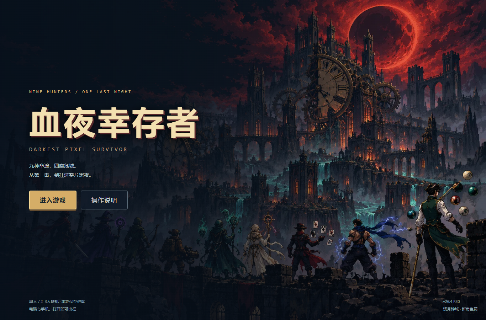

*标题与关卡插画为生成式像素 CG；下方战斗截图均由实际游戏渲染，成型演示使用真实升级卡配置构筑。*

前中后期实测与完整球量阶梯见 [R30 数值记录](docs/BALANCE_R30.md)。

## 这一夜，多了点蒜味

加了几处对《吸血鬼幸存者》的玩法致敬，以原创像素绘制，融入血夜的角色和世界观：

- **蒜香护符 → 黑蒜晨星。** 所有职业都可选的装备，占三格之一。每0.85秒伤害并推开近身小怪；升级扩大范围，达到装备Lv.5、人物Lv.20后可选独立觉醒，额外扩大范围、增伤，并在命中时每轮只为自己恢复2点生命。对Boss伤害为60%，不再触发流派连锁。
- **地上的烤鸡，还是能吃。** 原有45点恢复补给换上完整烤鸡像素图，继续按先到先得规则拾取。
- **有蒜你就来 / 这回真有吸血鬼。** 护符五级、墓园遇见吸血鬼各解锁一项新成就，分别奖励80和90金币，旧成就与已领金币保留。
- **天亮后的吐槽。** 通关统计底部会出现一行小彩蛋，和结算数据一起显示。

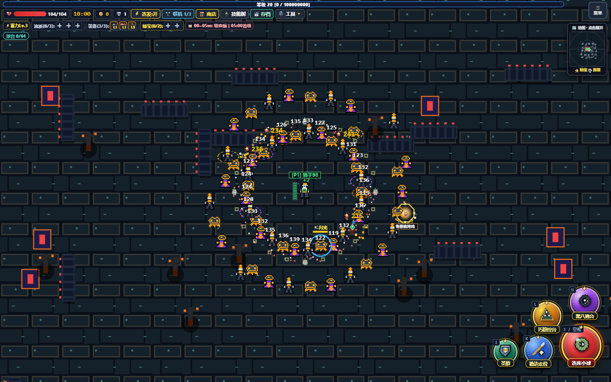

## 一局里能玩到什么

- **从小技能长成整套构筑。** 普攻、蓄力、战技、大招逐级进化；搭配配件解锁觉醒，再选择蓄力攻击的两条分支。
- **九个职业，九种战斗节奏。** 近战引爆流血、冰闪连锁控场、走位接回飞轮，锁定目标引导炮群轰炸，用圣域与羽翼阵支援队友，收集残魂带领亡军，玩台球连库、三式拳势，或四花轮转攒牌。
- **选三条流派，做自己的组合。** 七种流派中每局最多携带三种，配件最多三件。重刷优先给尚未出现的候选。
- **共享战场，掉落要抢。** 队友面对同一批怪物；经验水晶、金币、道具先到先得。每多一名玩家，怪物血量与掉落经验、金币增加 60%。
- **倒地还有下一次机会。** 队友站在尸体旁可救援；普通玩家一人需要 6 秒，两人一起 3 秒；祷师救援速度加倍，单人 3 秒，与一位普通队友协作 2 秒。倒地后可以切换队友视角。
- **随时结束本局，继续组队。** 房主在菜单点击「结束本局并返回队伍」，全员清空本局战场、回到同一个房间，保留房号、聊天和语音，再出征新一局。客人打开房间仍可返回当前战斗。
- **单人复活由自己确认。** 有破死重生次数时，倒地先显示3秒倒计时，再自行点击复活，恢复75%生命并获得3秒保护；不会自动站起。联机只使用队友救援，商店明确禁购仅限单人的复活天赋，已购等级保留。

## 这份图鉴可能对地狱的人事部门不太友好

「试用期见红」「阎王退单专家」「打不过就发工资」……原有43项成就保留，新加两项蒜香/吸血鬼彩蛋，现有45项，完成方法、进度和金币仍单独列明；旧奖励不会因改名再发一次。

九位猎手、34种魔物、24位首领补上灰色幽默小传，点击小图标才展开。比如冥契术士的招聘启事：*来都来了，死后也算出勤。* 玩笑之外，基础生命、接触伤害、移速、技能与解锁规则照常展示。

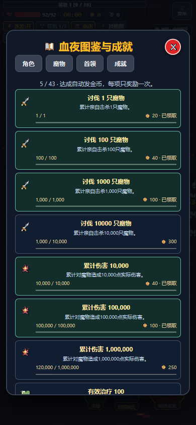

## 天赋可以小步调整

圣殿中每项天赋都有「＋ / −」。加一级先显示所需金币，减一级按该级记录的实付金额退款，其他天赋保持；全局费用倍率与角色属性立即更新，仍可一键全部重置。联机不适用的单人复活天赋不能继续购买，但已购等级可以逐级退回。

旧存档没有逐次购买顺序时，按原来的已投入总额分配各级退款；退款总额保持，不凭空增加金币。新购买会保存每一级的实际金额。

结算评分表可直接在数据行上左右滑动，查看伤害、治疗、护盾及击杀/救援；竖向滚动仍可找到返回队伍和重新出征按钮。

## 像素界面

162 枚原创像素图标覆盖角色、技能、拾取物、地图与菜单；九职业头像采用实际角色精灵。图集内置于 HTML，手机和电脑共用同一套画面。素材与源码均按 MIT 开源，见 [像素图集](assets/ui/README.md)。

## 认识九位猎手

| 职业 | 战斗方式 | 成型亮点 |
| --- | --- | --- |
| **苍红剑客** | 三段挥斩叠流血，突袭引爆，旋转重剑护身 | 多圈差速剑阵、适度收敛的裂空剑气与圣剑裁决 |
| **星界魔导** | 连锁奥术球、双点冰闪、推进黑洞 | 巨型冰晶法阵、白洞坍缩、连续三重星落 |
| **暗夜巡林** | 穿透毒弩、后跃布雷、走位接回旋镖，持续刷新战技 | 金色穿透圣轮、暗影分身与全向箭雨 |
| **烬铁机匠 · 火力重做** | 锁定钉攒热、磁雷聚怪、炮群集火 | 6 座三管炮台 + 4 座重装支援、炮网磁轨齐射、追踪火箭与巡航轰炸 |
| **冥契术士 · 死灵法师** | 自己与亡军击杀收魂，复苏怪物、号令集火 | 18位高血量成长亡军（含1位召唤领主），成长齐射与范围斩击，继承自己的装备与流派 |
| **曙光祷师 · 治疗辅助** | 圣光攒祷光，群疗转盾，圣域守阵与加速救援 | 七曜圣光审判、常青圣殿、8.5秒六翼审判；单人也能输出成型 |
| **终局球爵 · 台球猎手** | 小球连库、抽杆重球、擦边走位与巧粉控台 | 碰怪和发射时的视野边界反弹且100%无衰减；星轨漩涡与多向瞄准激光；大招加快普攻与蓄力、提升球上限与球速 |
| **风暴拳师** | 三式连拳每拳附带额外电击并攒最多6点拳势，蓄势崩拳消耗拳势 | 突进沿路出拳、雷鼓护盾阵、地面固定六道雷门高频电击；大招期间蓄力命中爆发范围雷暴 |
| **赤契牌师** | 方片欠条、梅花范围、黑桃穿透、红桃限频回复 | 蓄力随牌型发射扇形/集中一列/全范围飞牌（前期精简、随等级成长）；大招加快蓄力速度并强化发牌数与范围 |

### 三位新猎手，各自一套玩法

球爵每次碰撞反弹**保留100%伤害（无衰减）**，首次撞怪附带范围溅射，同球同敌最多3次；回弹重复命中不再反复触发流派。2技能与大招采用**环形星轨漩涡与多向瞄准激光交织冲击**特效，彻底告别生硬方框；大招期间加快普攻（间隔×0.65）与蓄力速度（耗时×0.60），并短暂提升同屏球数上限与38%弹射速度。拳师每拳命中的怪物都会额外被电击一次，大招六道雷门固定在地面持续高频电击范围内敌人，大招期间蓄力命中怪物更会在目标身上爆发范围雷暴。

牌师攒四张花色并在蓄力时按牌型变换华丽的立体扑克法阵与弹道：**同花**宽幅扇形齐射并追加两轮飞牌，**三条**全牌集中一列高速贯穿并连续三次点名，**两对**双翼扇形飞牌与自身护盾，**彩虹顺 / 王炸分支**触发360°全范围飞牌与范围裁决。前期普攻与蓄力发牌数量精简一半、随等级平滑成长至后期满屏火力；大招持续期间**自动加快蓄力速度（耗时×0.58）**，并大幅提升普攻与蓄力发牌数量与射程。手牌、锁花与鬼牌直接显示在状态栏。

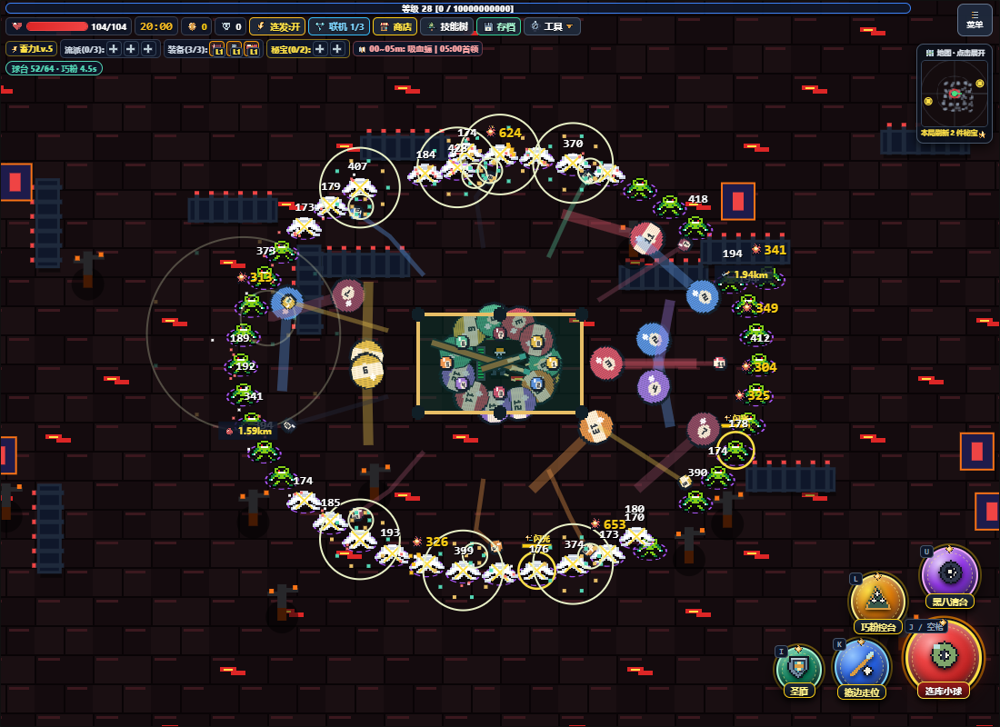

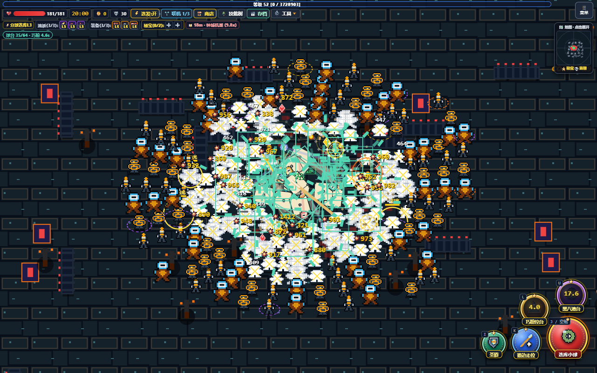

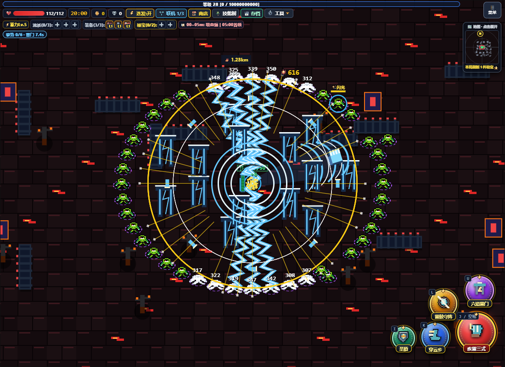

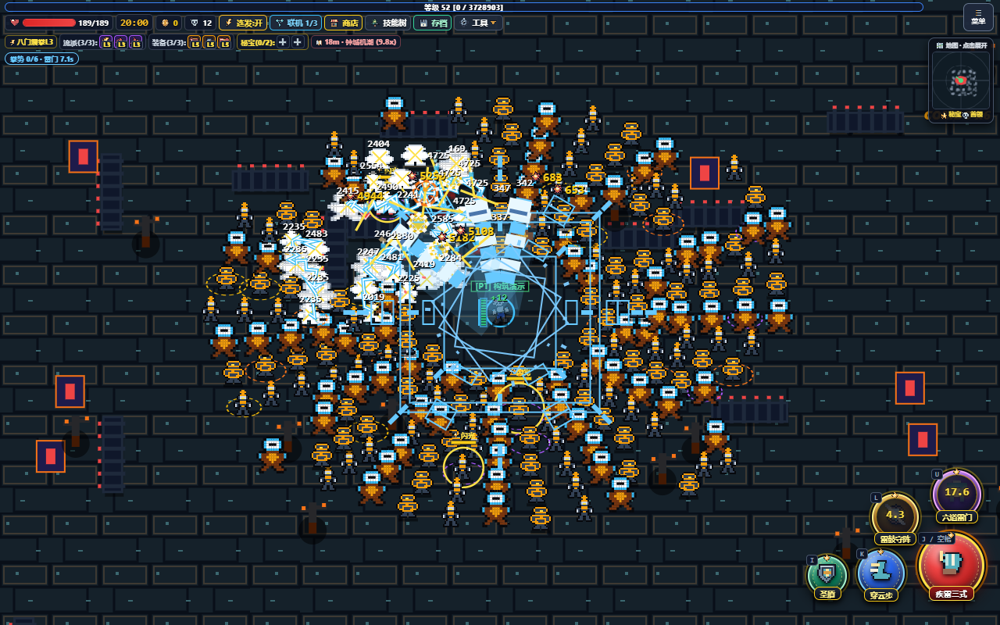

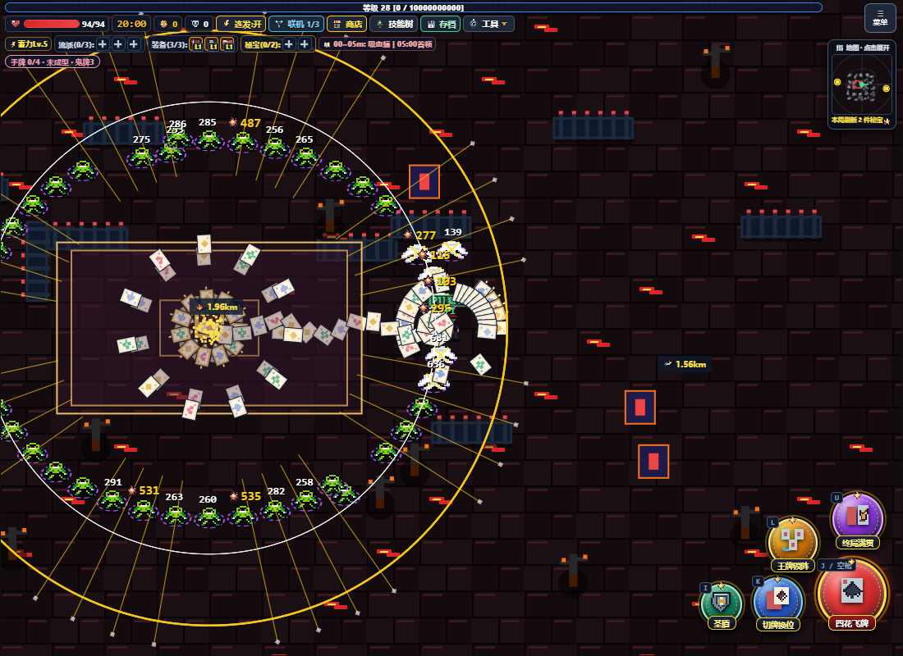

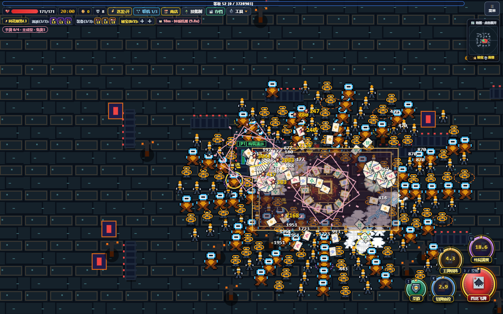

### 四关都有独立像素 CG

选中关卡后营地立即显示对应画面，前三关不再空缺。五幅标题/关卡 CG 均嵌入同一个 HTML，下载版也可显示；生成式插画与真实战斗截图分别标注。素材与提示词见 [CG 说明](assets/cg/README.md)。

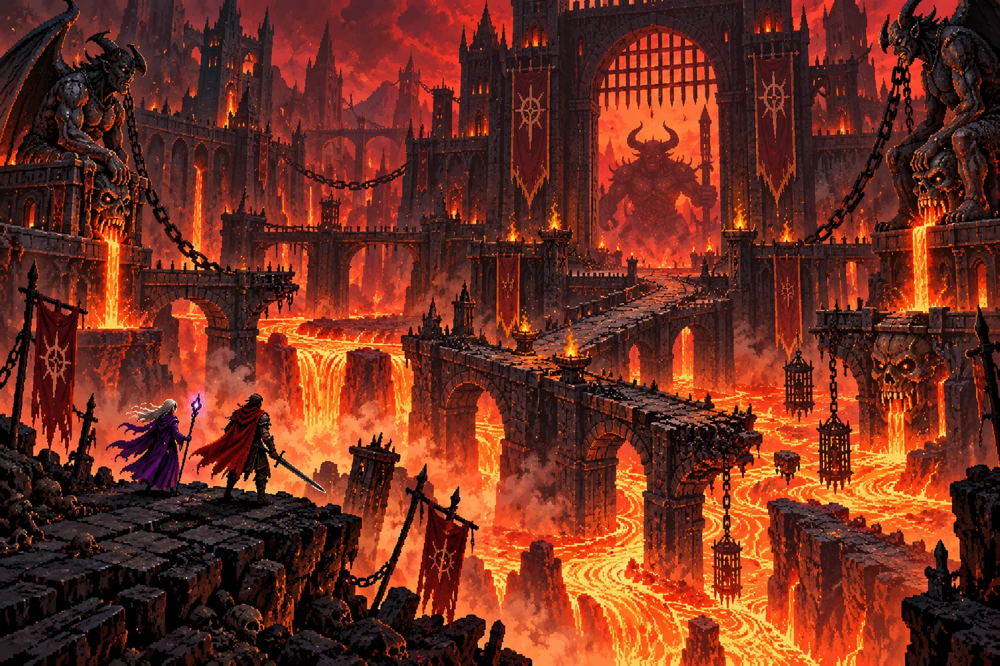


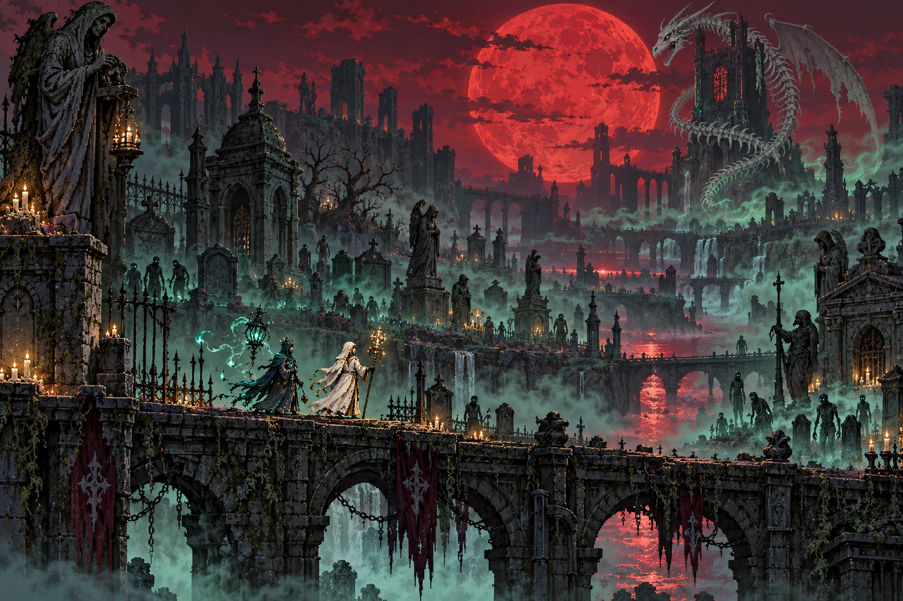

### 第四关：锈月钟城

发条铜鼠、巡游齿轮、锈钥卫兵、铜面术师、铸钟巨兵与失时幽影组成30分钟波次。每5分钟迎战一位钟城首领，30分钟挑战终末钟王：交错时针、带缺口的钟波、时隙棋阵、夜轨双线、摆锤和返场终钟各有预警与躲避空间。六位首领均有两招及半血变化，也支持商人招募与死灵领主的原生招式。

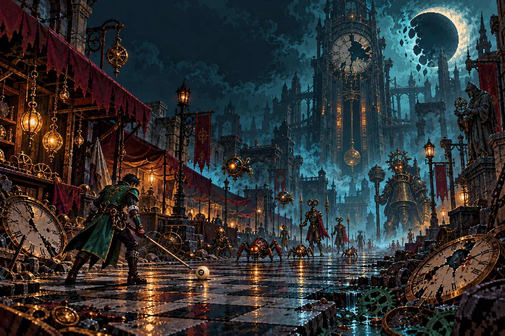

铜青地砖与独立芯片配乐《锈月发条圆舞曲》内置于游戏。逆摆怀表推进战技冷却，末班通票打出两条轨道，黄铜心簧震退并补盾；三件秘宝拾取即觉醒，放置点避开地形碰撞。

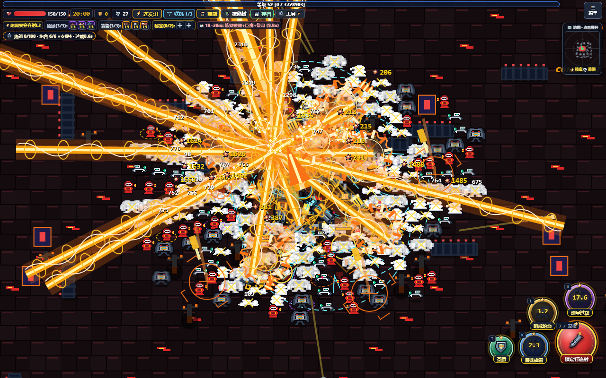

*烬铁机匠：满级觉醒后 6 座常规炮台与 4 座大招支援形成十炮台阵地；自己和炮群共同释放金色磁轨束。*

机匠的战斗循环是 **铺炮网 → 普攻锁定并攒热 → 满热三轮集火 → 蓄力或过载轰炸**：

- 普攻升级为 6 枚贯穿锁定钉，每第三次觉醒普攻附带双追踪火箭；手持攻击指定炮群优先目标。
- 热能满时自动触发炮网三轮齐射；也可以提前蓄力，消耗已有热能强化重炮。
- 磁雷先牵引附近小怪，再延时爆破，把敌人聚进交叉火力范围。
- 蓄力二选一：**炮网贯穿齐射**让自己与全部炮台共同开炮；**追踪火箭弹幕**发射 6–10 枚弧线追踪火箭，并指挥炮群集火。
- 觉醒大招展开重装机甲与四座限时支援炮台，持续9秒巡航轰炸。浮游炮从Lv.1一门逐步成长为Lv.5四门，自动瞄准540px内的敌人，每0.45秒每门发射一枚爆炸弹，觉醒后每门两枚；大招期间普攻间隔×0.65，蓄满时间×0.70，结束恢复。常规炮台也有寿命，需要补充与调整阵地。

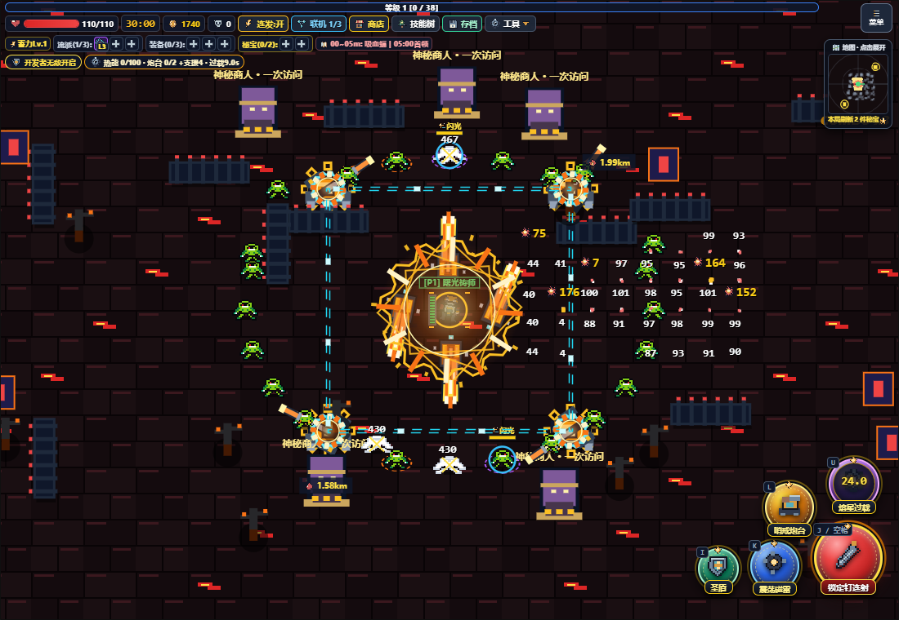

*浮游炮阵实机演示：缩小外围轮廓、移除粗支架，中心保留角色和走位空间。炮管瞄准与实际弹道共用方向；空场待机不假开火，开炮后才出现后坐、炮口焰和排烟。觉醒后使用双炮管，伤害仍由原有命中系统结算。*

## 概要先看懂，数值再展开

技能、流派、装备和秘宝卡片直接说明用途与触发方式；点击像素箭头再展开当前伤害、冷却、范围、成长与限制。概要不随折叠消失，鼠标、触屏和键盘都能操作。

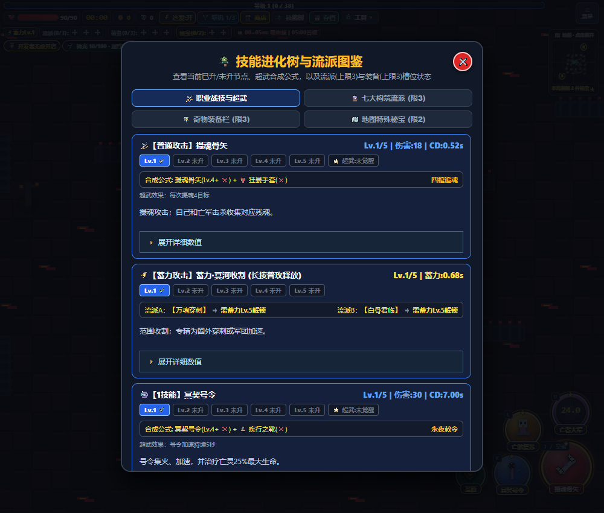

## 十二件地图秘宝，捡到就是觉醒形态

保持两个秘宝槽、不用额外选卡升级。伤害按**当前普攻伤害和玩家等级**共同成长，保留原有护甲、暴击、移速、金币收益；范围重叠不重复结算同一轮伤害。

| 秘宝觉醒 | 专属机制 |
| --- | --- |
| 炎魔之颅 · 炎魔陨星 | 每2.6秒六颗陨星点名敌群，范围爆破 |
| 炼狱荆棘甲 · 炼狱棘城 | 每3.2秒210px荆棘环，补充15%最大生命护盾 |
| 恶魔号角 · 血契三裁 | 每3.5秒三道血契裁决，命中恢复12%最大生命 |
| 永冬冰冠 · 永冬王域 | 每2.8秒230px寒潮；小怪冻结1.4秒，已冻目标额外碎冰伤害 |
| 霜狼图腾 · 霜狼奔袭 | 每2.8秒五道560px贯穿冰枪，同一轮同一目标一次 |
| 极光棱镜盾 · 极光天幕 | 每4.5秒四向540px棱镜光束；盾补至30%生命，保留24%战技与大招冷却推进 |
| 引魂冥灯 · 万魂引渡 | 每2.6秒六团追踪魂火，每团穿透两次，保留金币加成 |
| 伯爵披风 · 血月蝠群 | 每2.8秒八只追踪血蝠，命中限频吸血，每0.35秒最多恢复3%生命 |
| 死灵骨戒 · 冥王骨牢 | 每3秒170px骨牢爆破与六根骨柱，短暂束缚小怪 |
| 逆摆怀表 · 逆摆裁决 | 每3.1秒周身裁决，战技冷却额外推进12%，不影响圣盾 |
| 末班通票 · 末班双轨 | 每3.2秒打出两条520px轨道，重叠只结算一次 |
| 黄铜心簧 · 黄铜机心 | 每3.6秒195px震环，增加12%最大生命护盾，上限35% |

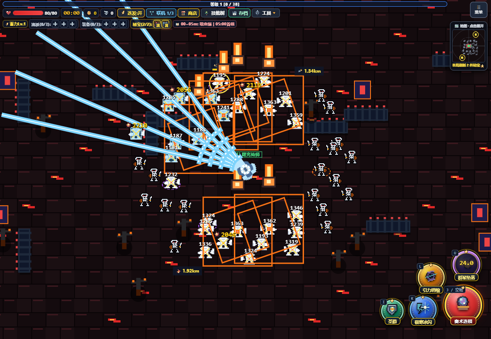

## 购买最多两位Boss，让以前的对手替你开路

每人每局最多可购买**两位**首领友军，沉睡期间也占用名额。**死灵法师的召唤领主另算**，因此死灵法师可以同时拥有一位召唤领主和两位购买Boss。

- 购买Boss自主寻找敌人、接近与贴身攻击，复用24种首领的48套原版招式：冲锋、环形波、扇形吐息、弹幕、交错直线及原本的召唤招式。
- 购买Boss的生命大幅提升为主人的**11.25倍**（较旧版提升4.5倍），召唤随从生命为主人的2.0倍，攻击按主人当前攻击与等级成长计算，继承主人的护甲；客机主人数据通过联机资料同步，伤害记给实际主人。不会复制敌方Boss随时间膨胀的数值。
- 原本会召唤小怪的Boss保留这项能力，每位购买Boss最多维持4个普通随从；死灵领主召出的随从纳入18人军团名额。
- 购买Boss血量归零后沉睡**10战斗秒**（原为30秒），再满血复苏。治疗不会把沉睡Boss提前唤醒；召唤领主阵亡后仍需要再次召唤。
- 奶妈的祷言、圣域、大招与满足祷光条件的蓄力群疗，同时治疗附近存活的玩家、亡灵、Boss和普通友军随从；有效治疗记给奶妈，重复网络回执不重复算。

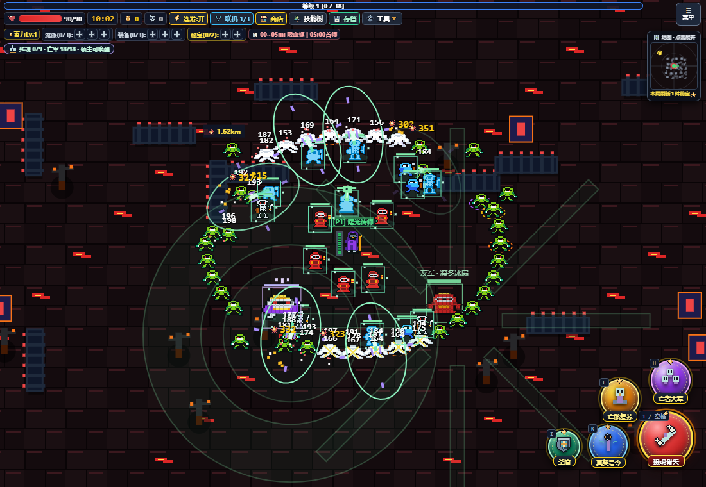

*机制演示使用实际游戏AI和伤害代码；部分目标固定且不反击，以清楚呈现招式，不代表自然通关实录。*

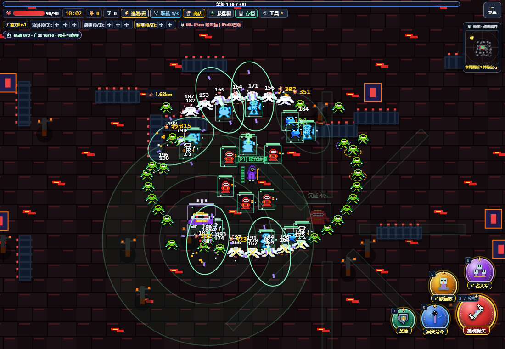

商人依然只访问一次。一种商品在这次访问中只能买一次，成交后标记已售罄；其他种类仍能购买。房主先预留库存，连续点击、不同请求编号及丢包重试不会重复扣款。已拥有的技能仍可在另一名商人处购买升级。

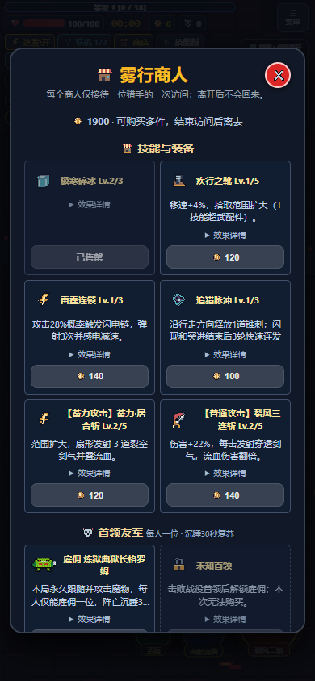

## 冥契术士：让自己击败的怪物成为亡军

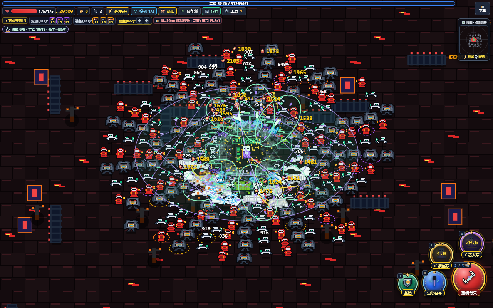

*使用真实升级卡配置的成型军团演示：尸潮、召唤物、光束与伤害均由游戏实际渲染。*

- **击杀收魂：** 自己或自己的召唤物完成击杀，才收集对应怪物的残魂；记录最多10种普通怪和3种首领。每3点残魂会在有位置时自动补一名骨仆，残魂最多储存9点。没有记录时使用基础骨仆外形。
- **摄魂骨矢：** Lv.1–5同时攻击1/1/2/2/3个目标，觉醒后4个。Lv.3起每三次普攻号令亡军攻击，最多18位参与，共用1.2秒间隔；近战必须贴身，远程会射出实际弹体。
- **蓄力·冥河收割：** 以自身为中心展开收割阵。满级分支二选一：万魂穿刺补上5–7道点名穿刺（仅圈外目标，伤害为收割的25%）；白骨君临让亡军加速5–7秒并补充骨仆。
- **冥契号令：** 范围冲击、集中攻击最近目标，治疗亡军各自最大生命的25%，短暂提高攻速和伤害；觉醒后持续5秒。
- **亡骸复苏：** 召唤常备骨仆，普通上限3/4/4/5/5，觉醒上限增加3；骨仆没有消失倒计时，只有阵亡才需要补充。觉醒获得范围斩击，每次最多命中8个目标。
- **亡者大军：** 五分钟前或大招低于Lv.3时只召唤小怪；**存活五分钟且大招Lv.3起增加一位领主**。优先使用自己收集的首领外形，没有记录时使用基础领主。Lv.1–5召唤6–10个小怪，觉醒为14个；全军最多18个，含最多1位领主，满编后不替换活着的亡灵，再次施放只补阵亡空位，已有领主也会保留。

亡灵的生命与伤害从**当前玩家属性与等级**计算，不复制怪物随时间膨胀的数值：普通亡灵基础生命提升为玩家的**270%**，领主基础生命提升为玩家的**550%**（均较旧版提升约4.5倍），并随2技能等级（每级+25%）、大招等级（领主每级+22%）、2技能觉醒（×1.35）以及玩家人物等级（每级+6%）持续倍率成长，后期面对高波次尸潮依然扎实耐抗。亡军继承玩家普攻成长、等级增伤、暴击和装备；可触发雷霆、极寒、余烬及永冬冰冠的主命中效果，业火命中可留下共用限频的火径。穿甲箭袋也可选择。周期型秘宝仍按玩家原有周期运行，不为每只亡灵复制一套。

全军共用0.18秒主命中触发间隔，连锁不能递归触发连锁；数量越多单次伤害适度衰减，对敌方Boss的亡军伤害再乘80%。亡灵没有存续倒计时，受到接触或弹体伤害、生命归零才退场。近战怪移动到贴身接触，邪术师、冰法师和骷髅射手保留远程身份，发射魂火、冰弹和骨箭；冰弹有短冻结。复苏的邪术师使用原怪物精灵。亡灵与怪物、友军、地形有碰撞体积；友军分离移动亡灵，不把玩家挤住。主人倒地后亡灵原地待命、仍可受伤，复活后继续作战；菜单和选卡期间停止攻击，结束战局时清理。

**收割不再靠倍率抢戏。** 蓄力伤害基数调整为普攻伤害×(1.45+0.18×等级)×(1+0.12×专精等级)，保留天赋和突破倍率；同一目标每次只结算一次收割。万魂穿刺只打圈外额外目标。本轮军团四阶段对比见[R27数值记录](docs/BALANCE_R27.md)，历史蓄力与满编实验保留在[R26记录](docs/BALANCE_R26.md)。

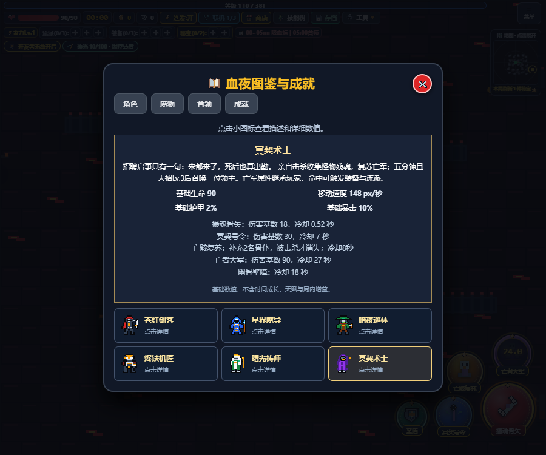

## 曙光祷师：能救队友，也能独自打成型

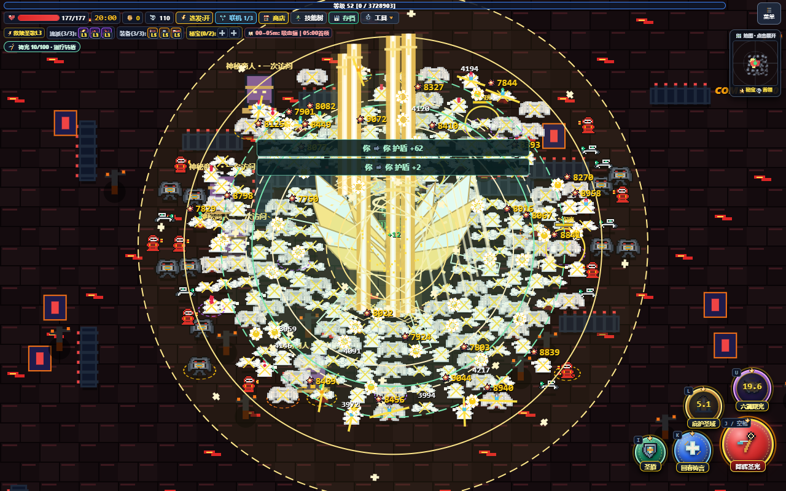

- **降辉圣光：** 普攻用较短的细圣光照落到怪物头顶，立即结算，无需等待飞射物。Lv.1–5分别审判1–5个目标，觉醒为七道圣光，附带小范围溅射；每次攻击积攒10祷光，上限100。
- **蓄力·祷光绽放：** 初始蓄满0.7秒，释放间隔约0.735秒；无天赋Lv.5分别约0.459秒和0.482秒；连发会等到冷却就绪再释放，避免空震屏。消耗祷光造成范围伤害；至少25点祷光时同时治疗附近玩家。满级二选一：更广的**救赎圣歌**，或10–14道贯穿光束的**审判光轮**。
- **回春祷言：** 立即治疗附近存活队友、亡灵与友方Boss，并为玩家加盾；溢出治疗的一半转为护盾，祷师带来的护盾最高为目标生命上限的35%。
- **庇护圣域：** 放置7秒圣域，每秒治疗，同时持续灼伤怪物。换阵地需重新部署。
- **六翼曙光：** 群疗、护盾和持续宽光柱范围审判；觉醒后延长至8.5秒，每轮最多选择8处范围审判（Lv.5觉醒）。
- **曙光返照：** 受到怪物攻击后，把护甲减伤后实际承受伤害的50%返还给实际攻击者，护盾吸收也计入；触发间隔0.5秒。反伤不暴击，也不再重复吃等级或其他伤害倍率。
- **救援速度×2：** 仍需站在倒地队友身边；祷师单人3秒，与普通队友一起2秒。治疗不会远程复活尸体。

全图冻结只停止怪物行动，祷师仍能持续蓄力、治疗与审判。突破与冷却秘宝形成的快速治疗也按实际冷却验证。

大招每轮用更宽、更矮的光柱覆盖小范围；一轮内重叠审判对同一怪物只结算一次。

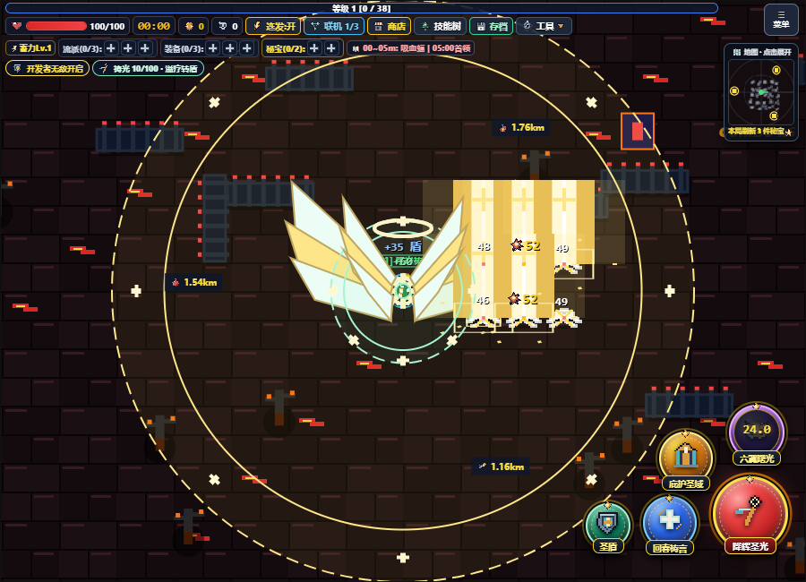

四项技能各有觉醒，沿用既有七流派与三配件限制。联机治疗由房主检查范围、状态和冷却，分别发给实际队友；重复消息不会重复回血。菜单、选卡和倒地期间停止自身施法。

## 从一门炮长成火力网

六位猎手的大招都能从Lv.1升至Lv.5，满级后再解锁觉醒。每级提高伤害、缩短冷却，技能轮廓与施法纹样随等级增强；各职业还有自己的数量、范围或持续时间成长。

| 机匠大招等级 | Lv.1 | Lv.2 | Lv.3 | Lv.4 | Lv.5 | Lv.5觉醒 |
| --- | --- | --- | --- | --- | --- | --- | --- |
| 浮游炮门数 | 1 | 1 | 2 | 3 | 4 | 4（双炮管） |
| 临时支援炮台 | 0 | 1 | 1 | 2 | 3 | 4 |

游侠每接回一枚飞轮，都可独立返还战技冷却并回血；没有每轮或累计次数上限。大招按一半比例返还，圣盾不返还。接轮、走位、再次投掷可以形成连续循环。

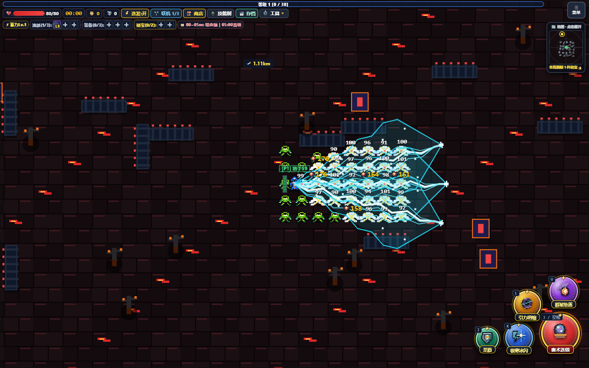

*追猎脉冲按实际移动计算，覆盖前方锥形内的怪物；背后不会自动寻敌。普通移动每次释放1/2/3道锥刺；闪现、瞬步、战士突进和游侠后跃在位移结束的位置连发三轮，每轮间隔0.09秒。满级每轮3道，共9道。保留移速越快、伤害与范围越高的成长；菜单、倒地和选卡会取消尚未发出的连发，普通站立与菜单传送不计入。*

## 战局贡献记得住

祷师治疗、护盾直接反映在生命条与护盾条，并在头顶分别显示绿色回血、蓝色加盾数字；取消页面“谁治疗了谁”的提示。房主与客机都能看到飘字，重复网络包不重复显示。结算仍计算有效回血与实际新增护盾，满血溢出不虚增治疗量。

战局结束显示全队伤害、治疗、护盾、击杀和救援，并综合角色贡献、存活时间与倒地情况给出C到S档评定。**S+只在通关时授予全队最强的一人**，治疗辅助也能拿到。短暂汇总结束后即可返回原队伍继续出征。

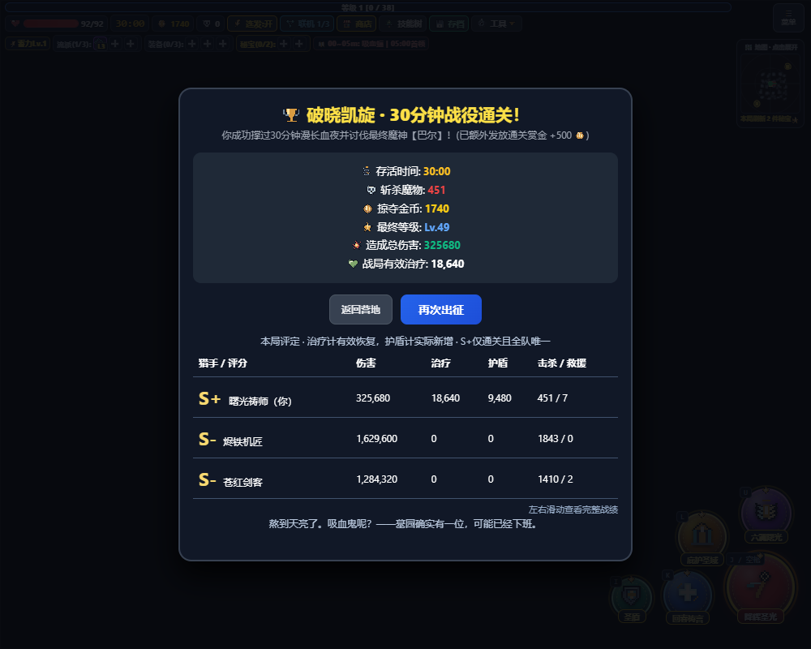

*结算布局示例使用预置统计展示评分界面；联机数值交付、归属与唯一S+另有真实双端RTC检查。*

## 商人的一次机会

在1分30秒、6、12、18、24分钟附近，会出现神秘商人，小地图与大地图均有标记。靠近后按E或点“访问商人”。

- 随机出售尚未选择的技能、流派和装备，也出售已有技能的升级，通常100–140金币，觉醒180金币。购买时仍需满足格子和前置条件。
- 花数百金币卸下战技、流派、装备或秘宝，腾出格子。卸下的主动技需要重新学习；已形成的觉醒不会因卸下配件而退化。
- 固定显示两个首领友军商品位置，优先随机展示自己已击败的首领，约480–780金币；不足两个时显示“未知首领”，尚未解锁无法购买。每位玩家本局最多雇佣两位。友军跟随并攻击，击杀收益归雇佣者。
- 每个商人只接待第一位访客的一次访问，访问期间可买多件；离开或90秒到期后离去，全队都不能再次访问。购买会再次检查金币与资格，重复消息不重复扣款。

技能与装备、首领友军、卸下格子分栏陈列。手机双列小格，技能用对应的像素图标，首领用实际精灵头像，点击“效果详情”再展开说明；营地军需商店也改为紧凑格子。

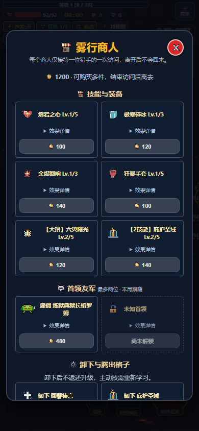

## 45项成就与血夜图鉴

营地新增“图鉴”和“成就”。角色、魔物与首领先以32像素小图标和名称展示，点击后再展开描述及基础数值，支持键盘选择。魔物在战场遇见后收录，24位首领战胜后解锁，并开放商人雇佣资格。

成就覆盖讨伐、伤害、治疗、护盾、救援、通关、商人、首领友军与职业收集等，共45项。达成后自动发放一次金币奖励，每个条目显示具体达成方法、进度、金币奖励与小像素图标；桌面双列、手机单列，缩小卡片留白。达成时自动弹出独立像素通知，显示名称、达成条件与金币；多项成就分批显示并自动收起，不暂停战斗，也不抢走移动与施法操作。记录随浏览器存档及完整存档码保存。

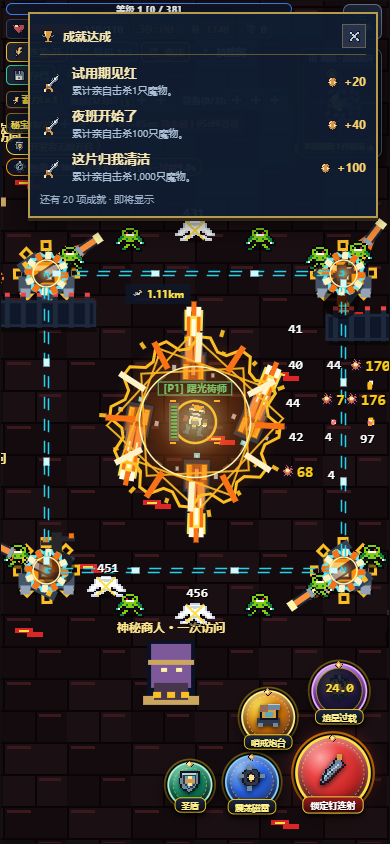

*通知演示由实际成就奖励函数触发，使用预置进度展示界面。*

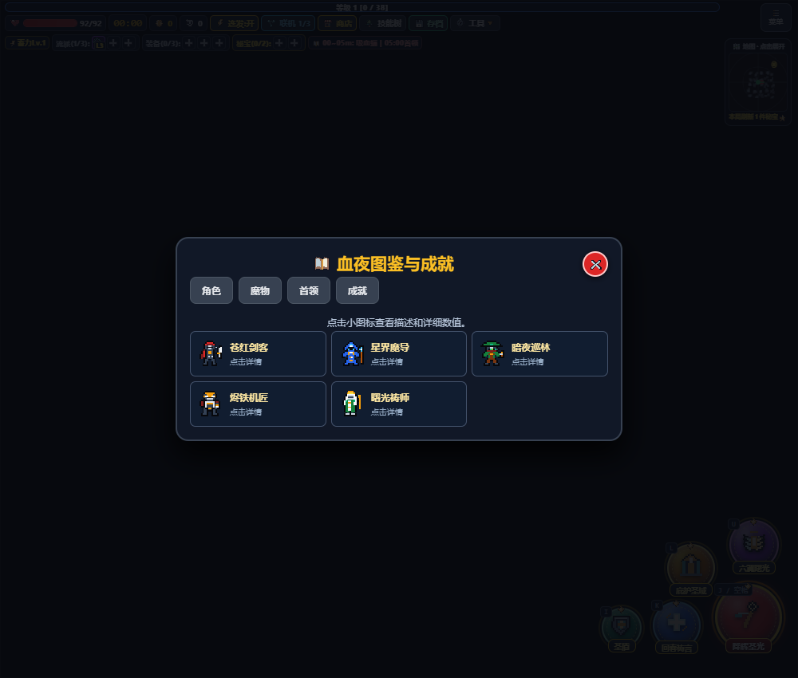

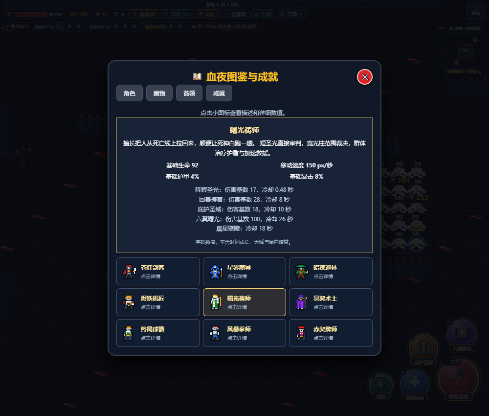


## 技能树不再只看名字

点开技能树里的任意技能、配件、流派或秘宝，展开当前等级的伤害基数、冷却、范围、治疗、护盾和触发条件；未获得的普通技能标明为Lv.1预览，秘宝预览直接展示完整效果。展开详情即可阅读，键盘也可操作。伤害基数与实际命中伤害分开说明，治疗数值不混入暴击和伤害增益。

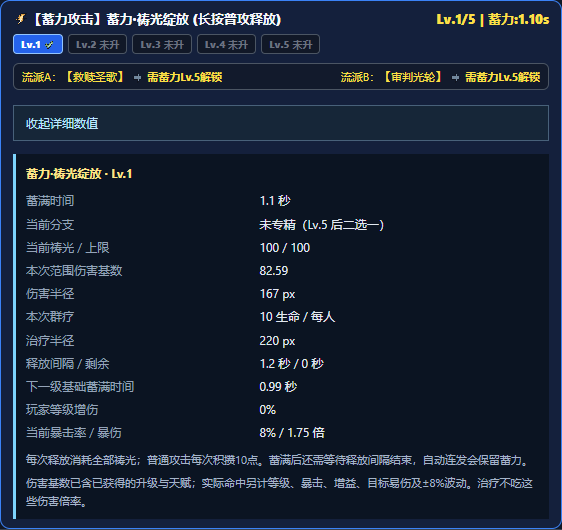

*截图来自游戏中的实际数值面板。多人查看详情不会暂停队友，也不会重置10秒菜单保护时间。*

## 四张地图，不同走位

| 地图 | 空间形状 | 边界 |
| --- | --- | --- |
| 恶魔熔火地牢 | 四向无限 | 保持原有开放地图 |
| 极寒永冬冻原 | 纵向无限 | 横向宽1280，左右有墙 |
| 幽冥血月墓园 | 横向无限 | 纵向高960，上下有墙 |
| 锈月钟城 | 四向无限 | 开放的钟城街区，发条魔物与钟楼首领 |

小地图和大地图均显示墙线及墙外阴影；大地图保留以自己为中心的递增距离圈，所以边界会随距离投影成曲线。主延伸方向不封口。秘宝位于地图内部，避开围栏、树木、冰块和石棺，方向地图保留可直行的中央通路。

## 秘宝拿到就成型

十二件地图秘宝拾取即觉醒，不再需要升级；旧秘宝保留原Lv.5的常驻属性，新秘宝直接启用钟城专属机制，仍最多携带两件。秘宝升级与突破卡不再占用选卡；伤害公式继续随玩家等级成长。

例如荆棘秘宝增加21个百分点护甲（受总护甲上限限制）、战角增加18个百分点暴击率、极光棱镜让战技与大招冷却额外推进24%；各秘宝的实际攻击数量与觉醒机制见上表。低级旧战局秘宝会补齐缺失属性，重复恢复不会叠加。

## 七种流派，组合出自己的打法

| 流派 | 核心玩法 |
| --- | --- |
| 雷霆连锁 | 主攻击有概率引发弹射闪电链 |
| 极寒碎冰 | 攻击附带寒霜，击败减速敌人散射冰刺 |
| 猩红血棘 | 亲自击杀累计触发回血，满血溢出转护盾 |
| 业火流星 | 步行、冲刺、后跃和闪现均沿路径留下火径，燃烧敌人的死亡带来尸爆 |
| **余烬回响 · 新** | 每 4 次主命中引发范围爆破，带触发间隔 |
| **星辉壁垒 · 新** | 每 6 秒补充自己的护盾，护盾量有上限 |
| **追猎脉冲 · 新** | 沿行走方向释放电流锥刺；实际移速越高，刷新越快、伤害越高、范围越大，闪现/快速突进结束后在落点三轮连发 |

雷霆连锁继承首击的实际伤害比例，不重复叠加暴击与等级增伤；自己重叠的熔岩领域每目标每0.3秒合并到期脉冲，最强四处按100%/50%/30%/20%递减叠加，最多为等伤最强单场的2倍，多个玩家独立结算。

火径每40px或移动0.35秒采样一次，快速位移中途也能命中敌人；自身重叠火径共用每目标0.3秒伤害间隔，避免密铺导致多倍叠伤。

新流派适用于全部九个职业，各有三级成长；流派、配件的槽位限制会在选卡页与技能树中显示。


*星界魔导：冰闪、引力黑洞与群星坠落叠加。队友使用同一套原版特效绘制，保留技能原色与觉醒形态。*

## Boss 要换打法

玩家技能和秘宝的冰冻对Boss只施加寒霜，避免持续硬控让招式失效；全图冻结道具仍然有效。

四张地图各有六位阶段 Boss，**共 24 套攻击组合、48 个招式**。它们会交替使用两种招式，半血后强化节奏、范围或连招；有扇形龙息、带安全缺口的寒潮、连砸、通道、召唤阵和交错镰刃。红色预警的形状就是实际危险范围，读起手、找缺口、抓收招再反击。

<details>
<summary>查看 24 位 Boss 的招式</summary>

| 时点 | 熔火地牢 | 永冬冻原 | 血月墓园 | 锈月钟城 |
| --- | --- | --- | --- | --- |
| 05:00 | 典狱长：锁链冲锋 / 扇斧处刑 | 比蒙：冰河践踏 / 巨兽扑击 | 缝合屠夫：钩镰拖斩 / 腐毒陷地 | 锈钥监工：交错时针 / 齿轮突击 |
| 10:00 | 熔火巨像：碎地三连 / 熔核外环 | 寒冰女巫：八方冰牢 / 凛冬冰扇 | 死灵君王：骸骨禁阵 / 死灵骨墙 | 空响铸钟者：钟声缺口 / 三重落锤 |
| 15:00 | 痛苦女王：魅影剪刀 / 旋舞花刃 | 冰霜巨龙：极寒龙息 / 冰翼横扫 | 摆渡人：冥河分流 / 渡魂舟影 | 失时工坊主：时隙棋阵 / 逆时弹环 |
| 20:00 | 深渊炎魔：熔岩十字 / 焦土追猎 | 极北冰皇：冰封棋径 / 王权交错 | 鲜血女皇：鲜血花环 / 血影连猎 | 夜轨列车长：夜轨双线 / 检票封锁 |
| 25:00 | 混沌魔眼：魔眼扫视 / 虚空螺旋 | 永冬泰坦：雪崩推进 / 陨冰震地 | 亡灵骨龙：骨翼风道 / 亡骸龙息 | 倒转占星仪：摆锤交错 / 星盘分野 |
| 30:00 | 巴尔：灭世棋盘 / 末日三重奏 | 利维坦：绝零缺口 / 往返寒潮 | 纳迦什：灵魂收割 / 生死轮转 | 终末钟王：午夜十二响 / 返场终钟 |

</details>

## 喊朋友一起玩

1. 所有人用正常浏览器打开 **[在线版](https://582835293.github.io/darkest-pixel-survivor/)**，先点击「进入游戏」，再填写昵称、选择角色。
2. 房主创建公开房或密码房，朋友输入房号加入。也可以浏览公开房间列表，或快速匹配公开房。
3. 队伍到齐后点击“出征”。需要语音时打开“交流”，再点“开启麦克风”申请权限。

更新游戏后，所有队友确认同一版本，再重新开房。

房间支持命名、房号查重和人数限制。连接优先尝试 P2P 直连，大厅的“连接线路”会显示实际路径与往返延迟；房主可以选择备用线路。

- **交流能边打边看：** 文字默认以顶层弹幕显示；支持 WebRTC 语音、仅收听、静音和退出语音。
- **升级不用等队友：** 升级者暂时受到保护，有 20 秒选卡，超时随机选择；其他玩家继续战斗。
- **菜单与全队暂停分开：** 多人打开菜单只停止自己的操作，并获得最多 10 秒菜单无敌，切换嵌套菜单不重新计时。到期继续停在菜单仍会受伤。只有房主的专用按钮可以暂停、恢复整场对局。
- **方向和队友随时可查：** 屏幕边缘有队友箭头与距离，点击小地图可展开带距离圈的大地图。
- **特效与音量自己调：** “菜单 → 系统设置”分别调整自己/队友技能透明度、语音、音乐与音效音量。

<details>
<summary>查看联机大厅与地图</summary>

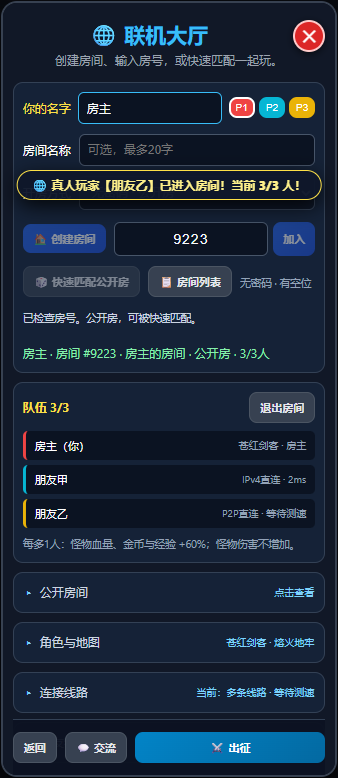

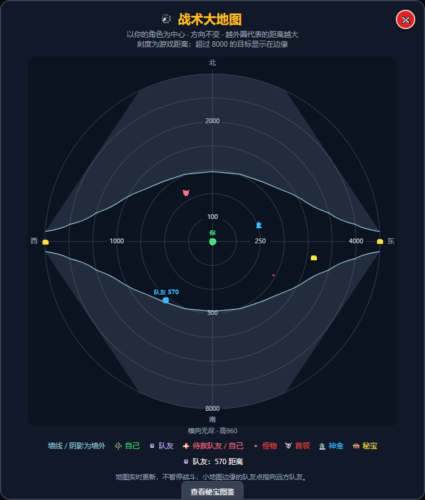

</details>

## 操作

| 操作 | 电脑 | 手机 |
| --- | --- | --- |
| 移动 | WASD / 方向键 | 左侧摇杆 |
| 普攻 / 蓄力 | J / 空格，长按蓄力 | 点击 / 长按普攻 |
| 两项战技 | K / L | 对应技能按钮 |
| 终结技 / 护盾 | U / I | 对应技能按钮 |
| 菜单 | P / 右上角“菜单” | 右上角“菜单” |
| 访问附近商人 | E | 靠近后点击访问按钮 |

蓄力与连续黑洞爆炸不再震屏；大招、受伤和首领登场等关键事件保留最多3像素、0.12秒的轻微反馈，全局间隔至少0.65秒，后续事件不会延长当前震动。

可开启普攻连发辅助，把注意力留给走位与技能。出征与关闭菜单/聊天后自动归还战场焦点，并清除残留按键；兼容物理键位与旧式按键事件，聊天时不触发技能，切出窗口会清除按住状态。Chrome、Edge、Firefox已分别用正常动画循环测试九职业移动与K/L实际伤害。单人菜单会正常暂停。

多人开发者权限默认关闭，由房主在开发者面板设置本房间密码；客人验证后还需房主明确批准。换密码或关闭权限会撤销已有授权，退房后密码与授权清空。单人的隐藏口令不会出现在界面提示中。

## 存档与访问

返回营地会结束并清理本局，金币与永久天赋保留。“进入战场”始终开启新局，不再在营地显示“继续上次战局”。联机结算后保留队伍和语音。若浏览器意外关闭，可在“存档管理”手动恢复单人断点。

存档保存在**各自浏览器的 `localStorage`**，没有云存档。更新同一网址可继续使用原存档；换设备、浏览器、域名，或从本地 HTML 迁移时，可在“存档管理”导出完整 `PSSAVE_` 存档码，再到新环境导入。建议定期备份。

游戏本体是一个 HTML 文件，也可以下载 [index.html](index.html) 本地打开。手机文件预览器的 `content://` 环境可能无法申请麦克风权限，需要语音时请使用 HTTPS 在线版。

GitHub Pages 只分发游戏文件。P2P 连接取决于双方网络；公共备用线路没有服务质量保证，当前也未内置付费 TURN。具体机制、房号查重边界与线路说明见 [联网文档](docs/NETWORKING.md)。

## 开发与开源

游戏逻辑、界面、原版特效和像素精灵均在 [index.html](index.html) 中；游戏本体无需安装 npm 依赖。仓库检查覆盖真实本地 RTC、技能与伤害归属、房间、语音、存档、界面，以及原版/队友特效对比。

```bash
npm ci
npx playwright install chromium
npm run check
npm test
```

R30共40套592项回归（含16项重做、31项扩展、14项致敬专项，定向复测后通过）、Chrome / Edge / Firefox正常动画循环输入测试，见[验证记录](docs/TESTING.md)。九职业、四阶段、两种成型分支的180场固定靶数值实验，以及90场有真实移动与敌人伤害的短时遭遇战，见[平衡方法与数据](docs/BALANCE_R30.md)。这些检查不等于安卓真机跨网测试或真人30分钟通关；不会用短时DPS宣称所有构筑绝对平衡。

开发测试可通过 `PLAYWRIGHT_EXECUTABLE_PATH` 指定已有 Chromium / Edge。详见 [验证说明](docs/TESTING.md)；测试结果与临时画面保存在被 Git 忽略的 `test-results/`。

运行 `node scripts/capture-frontdoor-r30.cjs` 可重建标题页与四关预览，`node scripts/capture-r30.cjs` 可重建三位新角色的满构筑战斗截图，`node scripts/capture-r30-details.cjs` 单独展示其原生特效。五幅CG均内嵌HTML，单文件本地运行不需要图片服务器。

运行 `npm run icons` 可导出原创 PNG 图集及坐标表。运行 `npm run screenshots` 可重建首页的满级构筑演示图：通过真实升级卡配置角色，再生成怪潮并捕捉实时游戏画面。

运行 `node scripts/capture-r25.cjs` 可重建追猎脉冲、圣光普攻、商人、成就、图鉴与结算布局示例；结算示例使用预置统计，脚本不连接公开玩家房间。

欢迎通过 [Issues](https://github.com/582835293/darkest-pixel-survivor/issues) 提交问题和玩法建议。报告联机问题时，附上游戏版本、双方设备/浏览器、实际连接线路与 RTT，会更方便排查。

采用 **[MIT 许可证](LICENSE)**，允许修改、分发与商用，保留版权及许可声明。
