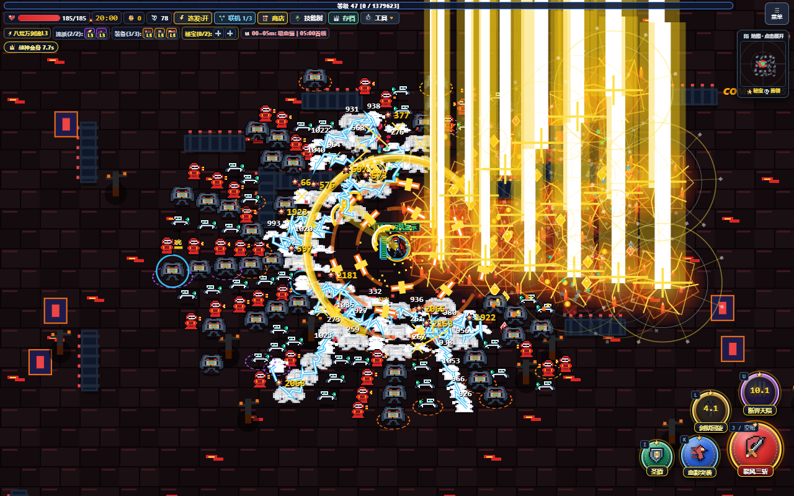

# 血夜幸存者 · Darkest Pixel Survivor

**把一套技能养成满屏火力，和朋友一起扛过下一波尸潮。**

暗黑像素风生存游戏。四个职业、七种流派、三张战场与 18 位独立招式的 Boss；支持单人，以及 **2–3 人浏览器联机**。电脑与安卓打开网页就能玩，无需注册游戏账号。

### [🎮 立即游玩](https://582835293.github.io/darkest-pixel-survivor/) · [📜 更新记录](CHANGELOG.md) · [💾 单文件源码](index.html)



*剑客成型：多圈剑狱、连锁雷光与三向黄金圣剑。以下截图均为游戏内的满级构筑演示画面。*

## 一局里能玩到什么

- **从小技能长成整套构筑。** 普攻、蓄力、战技、大招逐级进化；搭配配件解锁觉醒，再选择蓄力攻击的两条分支。
- **四个职业，四种战斗节奏。** 近战引爆流血、冰闪连锁控场、走位接回飞轮，或锁定目标、积攒热能，引导炮群集中轰炸。
- **选两条流派，做自己的取舍。** 七种流派中每局最多携带两种，配件最多三件。重刷优先给尚未出现的候选。
- **共享战场，掉落要抢。** 队友面对同一批怪物；经验水晶、金币、道具先到先得。每多一名玩家，怪物血量与掉落经验、金币增加 60%。
- **倒地还有下一次机会。** 队友站在尸体旁可救援；一人需要 6 秒，两人一起只需 3 秒。倒地后可以切换队友视角。
- **打完继续组队。** 一局结束返回原队伍房间，保留房号、聊天和语音，再出征下一局。

## 认识四位猎手

| 职业 | 战斗方式 | 成型亮点 |
| --- | --- | --- |
| 🗡️ **苍红剑客** | 三段挥斩叠流血，突袭引爆，旋转重剑护身 | 多圈差速剑阵、三向 18 道黄金圣剑 |
| 🔮 **星界魔导** | 连锁奥术球、双点冰闪、推进黑洞 | 巨型冰晶法阵、白洞坍缩、连续三重星落 |
| 🏹 **暗夜巡林** | 穿透毒弩、后跃布雷、走位接回旋镖 | 金色穿透圣轮、暗影分身与全向箭雨 |
| ⚙️ **烬铁机匠 · 火力重做** | 锁定钉攒热、磁雷聚怪、炮群集火 | 6 座三管炮台 + 4 座重装支援、炮网磁轨齐射、追踪火箭与巡航轰炸 |


*烬铁机匠：满级觉醒后 6 座常规炮台与 4 座大招支援形成十炮台阵地；自己和炮群共同释放金色磁轨束。*

机匠的战斗循环是 **铺炮网 → 普攻锁定并攒热 → 满热三轮集火 → 蓄力或过载轰炸**：

- 普攻升级为 6 枚贯穿锁定钉，每第三次觉醒普攻附带双追踪火箭；手持攻击指定炮群优先目标。
- 热能满时自动触发炮网三轮齐射；也可以提前蓄力，消耗已有热能强化重炮。
- 磁雷先牵引附近小怪，再延时爆破，把敌人聚进交叉火力范围。
- 蓄力二选一：**炮网贯穿齐射**让自己与全部炮台共同开炮；**追踪火箭弹幕**发射 6–10 枚弧线追踪火箭，并指挥炮群集火。
- 觉醒大招展开重装机甲与四座限时支援炮台，持续 9 秒加速开火、巡航轰炸。常规炮台也有寿命，需要补充与调整阵地。

## 七种流派，组合出自己的打法

| 流派 | 核心玩法 |
| --- | --- |
| ⚡ 雷霆连锁 | 主攻击有概率引发弹射闪电链 |
| 🧊 极寒碎冰 | 攻击附带寒霜，击败减速敌人散射冰刺 |
| 🩸 猩红血棘 | 亲自击杀累计触发回血，满血溢出转护盾 |
| 🔥 业火流星 | 移动留下火径，燃烧敌人的死亡带来尸爆 |
| 💥 **余烬回响 · 新** | 每 4 次主命中引发范围爆破，带触发间隔 |
| ✨ **星辉壁垒 · 新** | 每 6 秒补充自己的护盾，护盾量有上限 |
| 💠 **追猎脉冲 · 新** | 移动累积距离，向附近敌人释放追猎电弧 |

新流派适用于全部四个职业，各有三级成长；流派、配件的槽位限制会在选卡页与技能树中显示。


*星界魔导：冰闪、引力黑洞与群星坠落叠加。队友使用同一套原版特效绘制，保留技能原色与觉醒形态。*

## Boss 要换打法

三张地图各有六位阶段 Boss，**共 18 套攻击组合、36 个招式**。它们会交替使用两种招式，半血后强化节奏、范围或连招；有扇形龙息、带安全缺口的寒潮、连砸、通道、召唤阵和交错镰刃。红色预警的形状就是实际危险范围，读起手、找缺口、抓收招再反击。

<details>
<summary>查看 18 位 Boss 的招式</summary>

| 时点 | 熔火地牢 | 永冬冻原 | 血月墓园 |
| --- | --- | --- | --- |
| 05:00 | 典狱长：锁链冲锋 / 扇斧处刑 | 比蒙：冰河践踏 / 巨兽扑击 | 缝合屠夫：钩镰拖斩 / 腐毒陷地 |
| 10:00 | 熔火巨像：碎地三连 / 熔核外环 | 寒冰女巫：八方冰牢 / 凛冬冰扇 | 死灵君王：骸骨禁阵 / 死灵骨墙 |
| 15:00 | 痛苦女王：魅影剪刀 / 旋舞花刃 | 冰霜巨龙：极寒龙息 / 冰翼横扫 | 摆渡人：冥河分流 / 渡魂舟影 |
| 20:00 | 深渊炎魔：熔岩十字 / 焦土追猎 | 极北冰皇：冰封棋径 / 王权交错 | 鲜血女皇：鲜血花环 / 血影连猎 |
| 25:00 | 混沌魔眼：魔眼扫视 / 虚空螺旋 | 永冬泰坦：雪崩推进 / 陨冰震地 | 亡灵骨龙：骨翼风道 / 亡骸龙息 |
| 30:00 | 巴尔：灭世棋盘 / 末日三重奏 | 利维坦：绝零缺口 / 往返寒潮 | 纳迦什：灵魂收割 / 生死轮转 |

</details>

## 喊朋友一起玩

1. 所有人用正常浏览器打开 **[在线版](https://582835293.github.io/darkest-pixel-survivor/)**，填写昵称、选择角色。
2. 房主创建公开房或密码房，朋友输入房号加入。也可以浏览公开房间列表，或快速匹配公开房。
3. 队伍到齐后点击“出征”。需要语音时打开“交流”，再点“开启麦克风”申请权限。

更新游戏后，所有队友确认同一版本，再重新开房。

房间支持命名、房号查重和人数限制。连接优先尝试 P2P 直连，大厅的“连接线路”会显示实际路径与往返延迟；房主可以选择备用线路。

- **交流能边打边看：** 文字默认以顶层弹幕显示；支持 WebRTC 语音、仅收听、静音和退出语音。
- **升级不用等队友：** 升级者暂时受到保护，有 20 秒选卡，超时随机选择；其他玩家继续战斗。
- **菜单与全队暂停分开：** 多人打开菜单只停止自己的操作，并获得最多 10 秒菜单无敌，切换嵌套菜单不重新计时。到期继续停在菜单仍会受伤。只有房主的专用按钮可以暂停、恢复整场对局。
- **方向和队友随时可查：** 屏幕边缘有队友箭头与距离，点击小地图可展开带距离圈的大地图。
- **特效与音量自己调：** “菜单 → 系统设置”分别调整自己/队友技能透明度、语音、音乐与音效音量。

<details>
<summary>查看联机大厅与地图</summary>


</details>

## 操作

| 操作 | 电脑 | 手机 |
| --- | --- | --- |
| 移动 | WASD / 方向键 | 左侧摇杆 |
| 普攻 / 蓄力 | J / 空格，长按蓄力 | 点击 / 长按普攻 |
| 两项战技 | K / L | 对应技能按钮 |
| 终结技 / 护盾 | U / I | 对应技能按钮 |
| 菜单 | P / 右上角“菜单” | 右上角“菜单” |

可开启普攻连发辅助，把注意力留给走位与技能。单人菜单会正常暂停。

## 存档与访问

存档保存在**各自浏览器的 `localStorage`**，没有云存档。更新同一网址可继续使用原存档；换设备、浏览器、域名，或从本地 HTML 迁移时，可在“存档管理”导出完整 `PSSAVE_` 存档码，再到新环境导入。建议定期备份。

游戏本体是一个 HTML 文件，也可以下载 [index.html](index.html) 本地打开。手机文件预览器的 `content://` 环境可能无法申请麦克风权限，需要语音时请使用 HTTPS 在线版。

GitHub Pages 只分发游戏文件。P2P 连接取决于双方网络；公共备用线路没有服务质量保证，当前也未内置付费 TURN。具体机制、房号查重边界与线路说明见 [联网文档](docs/NETWORKING.md)。

## 开发与开源

游戏逻辑、界面、原版特效和像素精灵均在 [index.html](index.html) 中；游戏本体无需安装 npm 依赖。仓库中的测试覆盖真实本地 RTC、技能与伤害归属、房间、语音、存档、界面，以及原版/队友特效对比。

```bash
npm ci
npx playwright install chromium
npm run check
npm test
```

开发测试可通过 `PLAYWRIGHT_EXECUTABLE_PATH` 指定已有 Chromium / Edge。详见 [验证说明](docs/TESTING.md)；测试结果与临时画面保存在被 Git 忽略的 `test-results/`。

运行 `npm run screenshots` 可重建首页的满级构筑演示图：通过真实升级卡配置角色，再生成怪潮并捕捉实时游戏画面。

欢迎通过 [Issues](https://github.com/582835293/darkest-pixel-survivor/issues) 提交问题和玩法建议。报告联机问题时，附上游戏版本、双方设备/浏览器、实际连接线路与 RTT，会更方便排查。

采用 **[MIT 许可证](LICENSE)**，允许修改、分发与商用，保留版权及许可声明。
